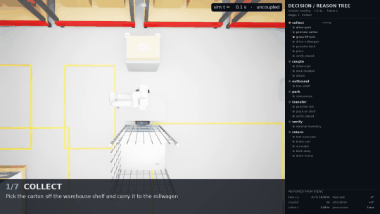
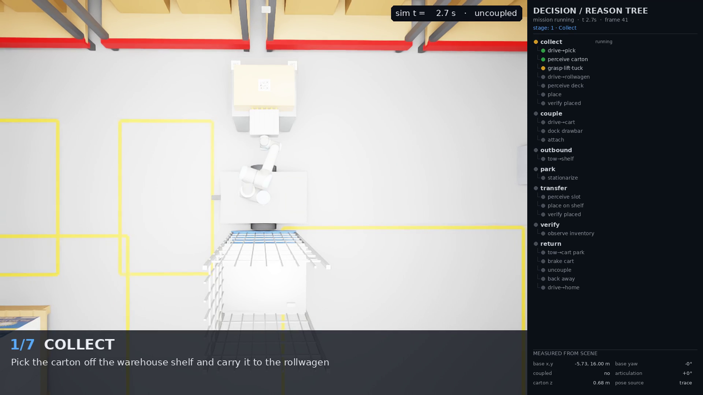
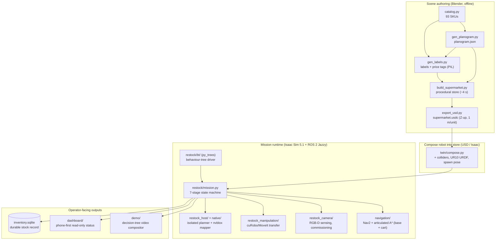
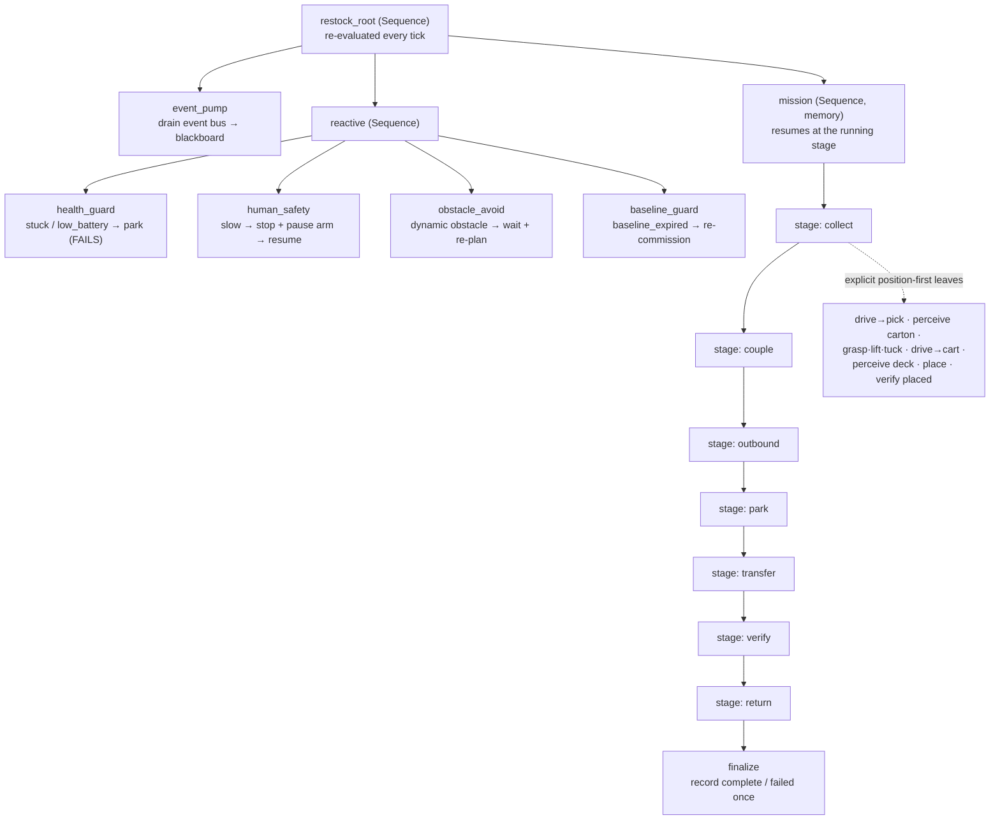

# Blender Supermarket — a generated store and a robot that restocks it

This repository builds a **photo-real supermarket entirely from data** and then runs a
**mobile manipulation robot through a full restocking mission inside it, in NVIDIA Isaac
Sim**. A procedurally generated Blender store (26 × 22 m, ~26 000 objects, 93 branded
SKUs) is exported to USD; a mobile UR10 on a towable cart then drives to the backroom,
picks a carton, couples the cart, tows it onto the sales floor, places stock on a shelf,
verifies the planogram and returns — all driven by a behaviour tree, sensor-gated at every
step. Everything is reproducible from committed source: the store from a catalog + planogram,
the mission from a state machine with measured evidence at every stage.

---

## Demo

A single run through all seven mission stages, with a live **decision / reason tree** panel
on the right showing what the robot is deciding and why (this is `mission/demo-008`, a compiled
walkthrough that stitches real Isaac-Sim footage for the early stages with choreographed footage
for the later ones — see [Results & known limitations](#results--known-limitations)).



▶ **Full-resolution video (43 s, 1080p):** [`docs/media/demo-008-mission.mp4`](docs/media/demo-008-mission.mp4)

The panel is rendered per-frame from the behaviour tree and the scene state, so pixels and
labels agree by construction:



---

## What's inside

### The thing being modelled

| Domain object | What it is | Where it comes from |
|---|---|---|
| **The store** | 26 × 22 m shop floor, 7 double-sided gondola runs, glass & open chillers, 4 checkout lanes, produce corner, bakery wall, aisle signage. ~26 000 objects, ~23 400 product instances, ~54 150 USD prims. | Generated by `scripts/build_supermarket.py` from a catalog + planogram |
| **The products** | 93 fictional-brand SKUs with real dimensions, packaging form, price, weight; printed labels and shelf-edge price tags. | `scripts/catalog.py` + `scripts/gen_labels.py` |
| **The robot** | A Universal Robots **UR10** (26 links / 25 joints, ~1.3 m reach) with a suction-panel gripper, mounted on a **differential-drive mobile base** (replaces the fixed pedestal). | `scripts/build_mobile_assets.py`, `docs/mobile_robot_rollwagen.md` |
| **The cart ("rollwagen")** | A passive three-sided cage trolley, 0.80 × 0.68 × 1.65 m, ~35 kg, four swivel casters, front drawbar. Robot + cart ≈ 215 kg towed. | `scripts/build_mobile_assets.py` (authors `rollwagen.usda`) |
| **The mission** | A 7-stage restock: **collect → couple → outbound → park → transfer → verify → return**, each gated on measured sensor evidence; inventory committed only at `verify`. | `scripts/twin/restock/mission.py` |

### Technology stack (versions as evidenced in the repo)

| Layer | Technology | Version (source) |
|---|---|---|
| Scene authoring | **Blender** (procedural build, EEVEE/Cycles render, USD export) | 4.5.13 LTS (`RUNBOOK.md`) |
| Interchange | **OpenUSD** | USD 0.24.5 bundled in Isaac; CPU validation via the `usd-core` wheel (`docs/twin_usd_facts.json`) |
| Simulator | **NVIDIA Isaac Sim** (+ PhysX, OmniGraph ROS 2 bridge) | 5.1.0 (`docs/isaac_robot_in_store.md`, `docs/restock_navigation.md`) |
| Middleware | **ROS 2 Jazzy** (rclpy; Isaac Python 3.11 / host Python 3.12 split) | Jazzy (`RUNBOOK.md`, `/opt/ros/jazzy`) |
| Mapping | **NVIDIA Isaac ROS nvblox** (ESDF obstacle map) | Isaac ROS 4.4 (`docs/navigation_temporal_mapping.md`, `native/.../package.xml`) |
| Navigation | **Nav2** (Smac Hybrid planner) + an articulated hybrid-A\* for base + towed cart | Jazzy Nav2 (`scripts/twin/navigation/nav2.py`, `docs/restock_navigation.md`) |
| Motion planning | **cuMotion / cuRobo** (`isaac_ros_cumotion`), MoveIt message API | cuRobo V2 ≥ 0.8.0 (`docs/arm_mpc_avoid.md`); `moveit_msgs` 2.6.0 (`docs/restock_manipulation.md`) |
| Mission driver | **py_trees** behaviour tree (ROS-free core; optional `py_trees_ros` viewers) | task-venv, version unpinned (`docs/restock_bt.md`) |
| Perception / vision | RGB-D wrist (eye-in-hand) + mast depth cameras, QR/fiducial decode (OpenCV), optional store-vision suite | `scripts/twin/restock_camera/`, `docs/restock_camera.md` |
| Python libs | numpy, OpenCV (`cv2`), Pillow, imageio-ffmpeg, sqlite3 (inventory) | versions not pinned in repo |
| Native code | one ament/ROS 2 package `restock_mapper_evidence` (nvblox mapper-evidence + admission policy) | `native/restock_mapper_evidence/` (Apache-2.0) |

> **No heavyweight dependency is vendored.** The URDFs (UR10 + gripper), cuRobo, Nav2 and the
> store-vision suite live in external workspaces and are *referenced*, not committed; this repo
> holds the store generator, the mission orchestration, the sensing/planning contracts, and a
> large suite of **offline CPU validators** that prove each piece without booting the simulator.

### Data & artifacts

- **Inputs a human edits:** `scripts/catalog.py` (products), the layout tables in
  `scripts/gen_planogram.py`, and the mission scenario (`scripts/restock_scenario.json`).
- **Generated offline & cheap (gitignored):** the built `.blend`, labels/signs, the USD export.
- **Versioned evidence:** the network-sourced base scene + textures, and GPU-hour render evidence
  (`renders/`, `report.html`). See [the file-policy table in `RUNBOOK.md`](RUNBOOK.md) and the
  decision log at the end of this README.
- **Formats:** USD (`.usdc`/`.usda`, Z-up, 1 m/unit, default prim `/Supermarket`), SQLite
  (`inventory.sqlite`, per-run), JSON configs and scenarios.

---

## How it works

### Architecture — from data to a running mission

The store is **data first, geometry second**: a catalog and a planogram drive a Blender build,
which exports to USD; Isaac Sim composes the robot into that USD and runs the mission, whose
stages are gated by three sensing/planning lanes and driven by a behaviour tree.



**The host / Isaac split.** The simulator runs on Isaac's Python 3.11; the motion planner,
nvblox mapper and arm trajectory executor run out-of-process on host ROS 2 Jazzy (Python 3.12),
connected over the OmniGraph ROS 2 bridge. This keeps cuRobo/nvblox off the simulator interpreter
and lets the whole planning stack be tested on CPU. See `docs/restock_host.md` and
`docs/restock_manipulation.md`.

### The mission — a behaviour tree over a 7-stage state machine

The canonical mission is a bounded **state machine** (`scripts/twin/restock/mission.py`): seven
stages in a fixed order, each requiring *measured* evidence (`source == 'sensor'`, fresh
timestamp, the stage's success field, e.g. `loaded`/`coupled`/`arrived`/`released`/`home`) before
it advances. Inventory is **reserved** at the start and **committed only at `verify`**.

The default run driver (`"bt": true`) ticks that same state machine through a
[py_trees](https://py-trees.readthedocs.io) behaviour tree
(`scripts/twin/restock/bt/`), which adds reactive safety handling and a live phone-friendly
visualization — reproducing the state machine **byte-identically** (same begin/step/finalize
calls, same durable record), proven on CPU by parity tests.



`event_pump` and `reactive` run **before** `mission` every tick, so a safety event is observed
and the control flags applied before the active leaf decides whether to step. Each stage is a
subtree of explicit **navigate → perceive → manipulate** leaves (`bt/stage_phases.py`); a step
failure is classified onto the timeline and retried within a bounded budget before the mission
fails honestly. Full contract: [`docs/restock_bt.md`](docs/restock_bt.md).

---

## Code structure

```
blender-supermarket/
├── scripts/
│   ├── build_supermarket.py        Procedural Blender store builder (catalog + planogram → scene)
│   ├── catalog.py / gen_planogram.py / gen_labels.py   Product data, layout tables, printed labels
│   ├── export_usd.py               Export the store to USD for Isaac Sim (Z-up, instanced)
│   ├── render_shots.py / render_walkthrough.py / gen_report.py   Stills, fly-through, HTML report
│   ├── build_mobile_assets.py      Author the mobile UR10 URDF + rollwagen cart USD (offline)
│   ├── compose_robot_in_store.py   Compose the UR10 into the store USD (+colliders, spawn pose)
│   ├── validate_usd.py / validate_robot_urdf.py / preflight.py   Offline (no-GPU) validators
│   ├── run_mobile_restock.py(.sh)  Mission: offline contract checks, or guarded Isaac run (--execute)
│   ├── run_restock_commissioning*.py   Commission empty-shelf baselines per station
│   ├── check_*.py / plan_*.py      ~30 CPU-only proofs (nav legs, reach, tow lanes, staging, cuts)
│   ├── run_*_gpu.py / *_gpu.sh      Guarded GPU/Isaac entrypoints (benches, probes, demo capture)
│   └── twin/                        Core package (stand the robot in the store, run the mission)
│       ├── compose.py / colliders.py / geometry.py   Pure-USD composition + placement maths
│       ├── gpu_guard.py / settle.py / urdf_probe.py / usd_probe.py   Guards & offline readers
│       ├── mobile*.py               Mobile base + cart controls, asset authoring, USD drive adapter
│       ├── restock/                 Mission layer (simulation-only orchestration)
│       │   ├── mission.py           Bounded 7-stage state machine (no Isaac/ROS imports)
│       │   ├── runtime.py           Integration adapter: nav, coupling, sensor-led transfer
│       │   ├── inventory.py         Transactional stock reservations + durable progress
│       │   ├── station*.py          Parked-station mapper lifecycle contract
│       │   ├── scripted_transfer.py Sim-only scripted transfer fallback (default off)
│       │   ├── isaac_*.py / native_*.py / masked_depth*.py   In-Isaac stage, cameras, transport
│       │   └── bt/                  Behaviour-tree run driver (tree, driver, leaves, events, view…)
│       ├── restock_camera/          CPU camera geometry + fail-closed depth calibration + QR
│       ├── restock_host/            Task-isolated host planner config + nvblox incorporation
│       ├── restock_manipulation/    Sensor-driven transfer: cuRobo→Isaac drives, MoveIt/ROS ports
│       ├── navigation/              Nav2 route + articulated A*, observed-space voxels, tow lanes
│       ├── demo/                    7-stage demo video compositor + decision/reason-tree panel
│       ├── humans/                  Optional simulated people + human-safety reaction (opt-in)
│       ├── route_alerts/            Robot as a mobile store sensor while it drives (opt-in)
│       ├── dashboard/               Phone-first read-only fleet dashboard (CPU, stdlib HTTP)
│       ├── tools/                   Developer benches/probes (arm carry, MPC, tow-path plot…)
│       └── tests/                   ~150-file pytest suite + fixtures (all subsystems, CPU)
│   ├── scenarios/                   Store-vision synthetic dataset generator (runs in Blender)
│   └── restock_runtime/             Task-local nvblox host-stack runtime closure + probes
├── native/restock_mapper_evidence/  ROS 2 (ament) package: nvblox mapper-evidence + admission policy
├── docs/                            Per-subsystem design docs (see table below) + docs/media/
├── data/                            Dated evidence / reports per deliverable (internal work logs)
├── scenes/supermarket_base.blend    Base scene holding the network-sourced materials + HDRI
├── assets/textures/                 Poly Haven PBR maps + world HDRI (externally linked)
├── renders/ · report_assets/ · report.html   Rendered stills, thumbnails, portable report
├── RUNBOOK.md                       Every command (build, render, export, mission, benches)
└── AGENTS.md                        Project build/architecture/sharp-edge notes
```

Key design docs under `docs/`:

| Doc | Covers |
|---|---|
| `restock_bt.md` | The behaviour-tree mission driver, tree shape, event contract |
| `restock_manipulation.md` | Sensor-driven transfer: grasp, cuRobo/MoveIt, gripper |
| `restock_navigation.md` | Mobile nav, coupled-cart swept envelope, tow lanes |
| `restock_camera.md` | Camera geometry, depth calibration, commissioning |
| `restock_host.md` | Isolated host planner + nvblox mapper |
| `mobile_robot_rollwagen.md` | Mobile UR10 + passive cart design |
| `isaac_robot_in_store.md` | Standing the robot in the store under Isaac Sim |
| `navigation_observed_space.md` · `navigation_temporal_mapping.md` | Depth-voxel & nvblox map contracts |
| `scenario-format.md` | Store-vision synthetic dataset format |
| `arm_mpc_avoid.md` · `route_alerts.md` · `fleet_dashboard.md` | Reactive arm MPC, store-sensor alerts, dashboard |

---

## How to run

### Prerequisites

- **Blender 4.5 LTS** (for the store generator / render / USD export).
- **Python 3** with `numpy` and the `usd-core` wheel (for the offline USD validators); `Pillow`
  for label generation; `pytest` for the test suite.
- **For the live mission only:** NVIDIA Isaac Sim 5.1, ROS 2 Jazzy, Isaac ROS 4.4 (nvblox),
  cuRobo V2, Nav2, and the external UR10 + gripper URDFs. A single RTX-class GPU. None of this is
  needed for the store generation or the CPU proofs.

Set `SUPERMARKET_ROOT` to the repo if you run scripts from outside it (otherwise they derive their
root from the script location).

### 1 — Generate the store and export to USD (offline, no GPU)

```bash
python3 scripts/gen_planogram.py            # layout → scripts/planogram.json (skip unless layout changed)
python3 scripts/gen_labels.py               # product labels + price tags → assets/labels, assets/signs
blender -b scenes/supermarket_base.blend --python scripts/build_supermarket.py -- --all --save scenes/supermarket.blend   # ~4 s
blender -b scenes/supermarket.blend --python scripts/export_usd.py                # → export/supermarket.usdc (~26 s)
python3 scripts/validate_usd.py export/supermarket.usdc                            # proves it is Isaac-loadable
```

**Expected:** a built scene of ~26 000 objects / ~23 400 product instances; a USD stage of
~54 150 prims (Z-up, 1 m/unit, default prim `/Supermarket`); the validator exits `0`.

### 2 — Prove the mission offline (CPU only, no Isaac)

```bash
# Robot-in-store pre-flight (store USD + robot URDF + composer), one command, no GPU:
python3 scripts/preflight.py

# Mission contract checks and targeted CPU proofs:
PYTHONPATH=scripts python3 -m pytest -q scripts/twin/tests/test_restock_mission.py
python3 scripts/check_restock_navigation.py          # nav planning/control evidence
python3 scripts/check_tow_lanes.py                   # coupled tow-lane feasibility

# Behaviour-tree layer (task-owned venv; never the shared Isaac env):
python3 -m venv .venv-bt && .venv-bt/bin/pip install py_trees pytest
PYTEST_DISABLE_PLUGIN_AUTOLOAD=1 PYTHONPATH= .venv-bt/bin/python -m pytest -q scripts/twin/tests/test_restock_bt.py
```

**Expected:** pre-flight prints `STORE / ROBOT / COMPOSER PASS` and exits `0`; the CPU proofs
pass without a GPU. These validators are the project's CI-style gate: a change is checked offline
before any simulator time is spent.

### 3 — Run the live mission (guarded, needs Isaac Sim + a free GPU)

```bash
# CPU preflight by default; append --execute only inside an authorized GPU session:
bash scripts/run_mobile_restock.sh --manifest "$ENVIRONMENT_MANIFEST" \
     --scenario scripts/restock_scenario.json

# Iterate a single stage without paying the whole cycle (dev bench):
PYTHONPATH=scripts python3 scripts/run_mobile_restock.py --start-at transfer \
     --start-staging recorded_bay_park --stop-after verify
```

The launch is **GPU-guarded**: it refuses to boot beside a heavy GPU consumer (e.g. an open
Blender session) to avoid an out-of-memory crash. A run writes a per-run directory with
`mission.json`, the `inventory.sqlite` record, the live `bt_view.html` tree view, and a rendered
`walkthrough.mp4`. Full command reference (commissioning, benches, nav, dashboard): `RUNBOOK.md`.

---

## Results & known limitations

**What works and is proven.** The store generator and USD export are deterministic and verified
byte-for-byte against committed copies; the offline validators (USD, robot URDF, pre-flight, nav
legs, tow lanes, staging, cut ranges) pass on CPU. The mission state machine and its behaviour-tree
driver are covered by a ~150-file CPU test suite, including a byte-identical parity test between the
two. Individual stages have been exercised live in Isaac Sim — a **real** carton pick, grasp/weld
attach, coupled tow through the service door, cart arrival, and shelf transfer — captured as the
demo footage above.

**Honest framing of the demo.** The hero video `demo-008` is a *compiled* walkthrough: its
`collect` and `couple` stages are **real** Isaac-Sim footage, while `outbound`, `park`, `transfer`,
`verify` and `return` are **choreographed** segments (scripted poses with the same compositor and
decision tree). An end-to-end, single-boot run of all seven stages has **not** yet been captured;
the current blockers are documented per-run in `data/` (GPU VRAM ceiling on a 12 GB card, sensor
freshness under render-paced simulation, and arm self-collision on the loaded lift). The suction
grasp uses a simulator "weld" (fixed-joint) attach rather than true suction sealing.

**What is simulation-only or external.** This is a **digital twin**, not hardware control: the
trajectory executor publishes joint-drive targets inside the sim and never commands a physical
robot. cuRobo, Nav2, the UR10/gripper URDFs and the store-vision suite are external dependencies,
referenced not vendored, so a live run requires their installation. Fixture/ground-truth evidence
is accepted only in tests; production rejects it.

---

## Licence & attribution

- **Repository licence: the owner's choice (not yet recorded in this repo).** No top-level
  `LICENSE` file is committed. The bundled native ROS package
  `native/restock_mapper_evidence/` declares **Apache-2.0**. Add a repo-wide `LICENSE` reflecting
  the intended choice before publishing.
- **Third-party components** carry their own licences: NVIDIA Isaac Sim / Isaac ROS / cuMotion
  (NVIDIA licences), cuRobo (Apache-2.0), ROS 2 Jazzy & Nav2 (Apache-2.0), Blender (GPL),
  py_trees (BSD), and the base scene's PBR materials + HDRI from **Poly Haven** (CC0).
- **Attribution:** developed by Aile Robotics. Brand names on the modelled products are
  fictional; the store, products and prices are synthetic.

---

## Decision log

Dated record of the choices baked into the repo. Newest first. (Commands live in `RUNBOOK.md`;
subsystem rationale in `docs/` and `AGENTS.md`.)

### Store generated from a catalog + planogram, not hand-modelled
Chosen so the store is editable, reproducible and **labelled by construction**: every product is
placed by code, so each object carries `sku, category, brand, price, slot, facing, row` custom
properties that survive the USD export as `userProperties:*` — free semantic / planogram-compliance
ground truth for a simulator. Products share one prototype mesh each and export as true USD
instances, so ~23 400 products cost a few hundred real meshes.

### USD instancing + Z-up metres for Isaac Sim
The export uses linked-duplicate → USD instancing and Z-up / metre units so the stage is light and
drops into Isaac Sim with colliders and physics added on the prototypes. The world HDRI is not
exported; light the imported stage with a dome light.

### Mission is a bounded state machine with measured evidence at every stage
Each stage requires fresh sensor evidence and the stage's success field before it advances; stock
is reserved up front and committed only at `verify`. The behaviour-tree driver reproduces this
state machine byte-identically while adding reactive safety handling and a live tree view — so the
safety reactions and the recorded outcome are the same whether or not the tree is used.

### File policy — ignore only what is offline AND cheap to regenerate
An artifact is gitignored only when its regeneration is both **offline** and **cheap** (seconds to
a minute): the built scene, labels/signs and the USD export. Network-sourced assets (base scene,
textures) and GPU-hour render evidence (`renders/`, `report.html`) are versioned. See the measured
cost table in `RUNBOOK.md`.
