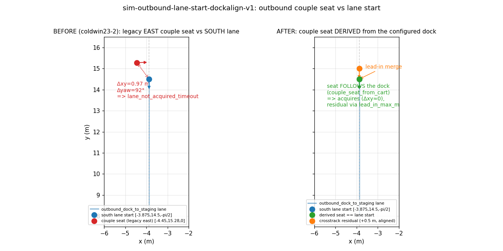

# sim-outbound-lane-start-dockalign-v1 — outbound tow-lane acquisition from the dock-align couple seat

Item 4 of `data/sim-followups-harvest-s1`. **CPU-proved, no GPU run from this lane** (the integration
lane owns the GPU; the bounded GPU proof is handed off below).

## Problem (coldwin23-2)

`coldwin23` (`start_at=couple --stop-after outbound`) proved the no-rotation claim in-sim
(1.96° max over 1459 coupled outbound rows) but then **failed `lane_not_acquired_timeout`**.

From the run console (`~/datasets/twin-robot-in-store-boot-v1/mission/coldwin23.console.log`):

- The `start_at=couple` shortcut synthesizes only the carton; the **couple stage runs for real**. Its
  nav drove to the **legacy EAST** couple pose `goal=(-4.46, 16.0, 0.0)` and the fine-dock seated the
  base at `pose=(-4.447, 15.28, 0.034)`, cart yaw `0.035` — **facing east**.
- The outbound lane was the dock-align **SOUTH** `outbound_dock_to_staging`, `start=(-3.875, 14.5, -π/2)`.
- Acquire therefore saw `xy_ok=False cart_ok=False` forever (**Δxy ≈ 0.97 m, Δyaw ≈ 92°**) →
  `lane_acquire_timeout lane=outbound_dock_to_staging sim_s=8.02` → `lane_not_acquired_timeout`.

Root cause: the couple **seat frame did not follow the outbound lane's dock**. The run's external config
paired a *legacy-east* couple drive with a *dock-align-south* lane. A gross 92° / ~1 m frame flip is not
something the lead-in can (or should) bridge, so every dock-align proof was forced to be a full cold run.



## Fix (two repo-side guards, both opt-in / default-off ⇒ byte-identical)

1. **Seat derivation — the lane start follows the configured dock.** New pure helper
   `twin.navigation.lanes.couple_seat_from_cart(cart_pose, …)` is the exact inverse of the couple hitch
   geometry (`restock.shortcut.cart_pose_from_hitch`): given **where the cart is docked**, it returns
   **where the robot ends up** once the fine-dock has seated the hitch (articulation 0, robot aligned to
   the cart). The same formula yields both docks:
   - dock-align SOUTH: cart `[-3.875, 15.77, -π/2]` → seat `[-3.875, 14.5, -π/2]` = the south lane start.
   - legacy EAST: cart `[-5.73, 15.25, 0]` → seat `[-4.46, 15.25, 0]` = the legacy east lane start.

   A `TowLane` may now **declare its `couple_dock`**; `TowLane.expand()` derives the seat and **refuses to
   build** if the lane `start` does not match it within `start_tol_xy`/`start_tol_yaw`. So a legacy dock
   paired with a re-authored lane (the coldwin23-2 class of bug) fails at build time, not at the GPU run.
   `couple_dock` absent ⇒ no validation ⇒ byte-identical.

2. **Per-lane lead-in — absorb the real crosstrack couple residual.** `outbound_dock_to_staging` now sets
   `lead_in_max_m: 1.0` (reusing `sim-robust-outbound-lane-start-v1`'s mechanism): when the real couple
   lands the base a little (≤ ~1 m) off the exact seat but **aligned**, the follower synthesises a bounded,
   swept-validated coupled merge onto the centreline instead of dead-locking. A gross frame flip (the
   east seat vs the south lane) still returns `None` → the acquire watchdog fails fast by name; the lead-in
   never silently absorbs a mismatch.

The dock-align **SOUTH couple poses** are now carried in the fragment's `mission_poses`
(`couple_approach [-3.875, 13.0, -π/2]`, `couple_standoff [-3.875, 14.1, -π/2]`); the fine-dock reverses
NORTH onto the drawbar and the robot ends at the lane start `[-3.875, 14.5, -π/2]`.

### Files

- `scripts/twin/navigation/lanes.py` — `couple_seat_from_cart`, `TowLane.couple_dock` + `synthesised_couple_seat`
  + `_validate_couple_dock` (called in `expand()`), `from_config` round-trip.
- `docs/examples/tow-lanes-mission-fragment.json` — `couple_dock` + `lead_in_max_m` on the lane; dock-align
  south couple poses; `_couple_seat_dockalign_note`.
- `scripts/check_tow_lanes.py` — `check_couple_seat_acquire`.
- `scripts/twin/tests/test_navigation_lanes.py` — `CoupleSeatDerivationTests`.

## CPU proof

`scripts/check_tow_lanes.py` → `TOW_LANES_PROOF PASS` (31 checks; full log `check_tow_lanes.out`). The new
`check_couple_seat_acquire` asserts, for **both docks**:

- `south_seat_follows_configured_dock` / `east_seat_follows_configured_dock` — derived seat == the matching
  lane start.
- `south_lane_acquires_derived_seat` / `east_lane_acquires_derived_seat` — the lane acquires its dock-derived seat.
- `south_residual_seat_acquires_via_leadin` — an aligned +0.5 m crosstrack residual acquires via the lead-in
  (89 merge states), where the direct acquire refuses.
- `east_seat_refused_by_south_lane` — the coldwin23-2 cross (east seat vs south lane) is refused by acquire
  **and** the lead-in returns `None` (no silent absorption).
- `mismatched_couple_dock_fails_to_build` — a legacy-east `couple_dock` on the dock-align-south lane raises at `expand()`.

Run:
```
PYTHONPATH=scripts python3 scripts/check_tow_lanes.py \
  --environment ~/datasets/sim-store-realism-v3-portal26/environment.json \
  --scenario scripts/restock_scenario.json \
  --lanes docs/examples/tow-lanes-mission-fragment.json
```
Unit tests: `PYTHONPATH=scripts PYTEST_DISABLE_PLUGIN_AUTOLOAD=1 python3 -m pytest
scripts/twin/tests/test_navigation_lanes.py` → 68 passed (incl. `CoupleSeatDerivationTests`).
No regression: `test_service_leg_carry.py`, `test_articulated_navigation.py`, `test_navigation_scenario.py`,
`test_outbound_heading_hold.py`, `test_restock_mission_tail.py`, and `check_shelf_staging_nav.py` all pass.

## Bounded GPU proof hand-off (integration lane)

With the dock-align south couple poses + the `outbound_dock_to_staging` lane (both in
`docs/examples/tow-lanes-mission-fragment.json`), run the bounded dock-align proof — **no full cold run**:

```
start_at=couple --stop-after outbound   (shelf_staging on; portal_floor_box=true;
  keep coupled_heading_hold / heading_hold_prethroat_m / heading_hold_launch_m from
  docs/examples/throat-momentum-launch-mission-fragment.json)
```

**Acceptance:** the coupled train couples south-aligned on the portal axis; outbound **acquires
`outbound_dock_to_staging`** from the couple seat (no `lane_not_acquired_timeout`); coupled articulation
**< 5°** the whole lane; the cart uncouples at `shelf_staging`. If the real couple lands the base slightly
off the seat, the `lead_in_max_m: 1.0` merge absorbs it (watch for `NAV_PLAN_DIAG lane_leadin …`); a true
frame mismatch fails fast by name.

## Out of scope / follow-ups

Lane geometry, side bay, and manipulation are out of scope (per the firstmate spec). The service-leg
carton-carry to the endcap (the uncoupled service leg must carry the carton) and the single-door return
remain integration-owned follow-ups (see the fragment's `_gpu_handoff_note` / `_return_handoff_note`).
