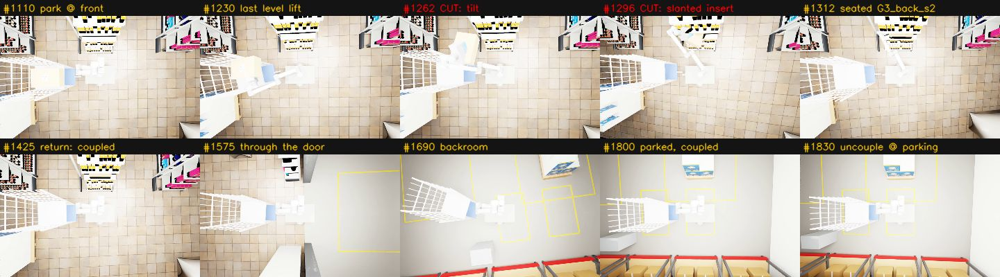

# sim-video-story-sources-v1: the two story segments demo-006 lacked

The captain's story is: pick in the warehouse onto the rollwagen, tow the rollwagen to the supermarket
front, **place it there**, then **tow robot + rollwagen back into the warehouse and park**. demo-006 had
no source for either bolded beat. This lane found what exists, cut out the faults, and specified the one
short GPU run that yields a clean front place. CPU only; mission dirs read-only.

Machine-readable: [`story_sources.json`](story_sources.json). Proposed compile spec (the compile lane
owns `compile-demo-006.json`): [`compile-demo-006-front.json`](compile-demo-006-front.json). It compiles
on CPU in 78 s into 668 frames (44.5 s), with stage captions "Place on the supermarket shelf" and "Return
to the warehouse".



## Headline

1. **No real run ever reached the sales floor.** Of the 371 run dirs with a `nav-trace.jsonl`, none
   puts the base below y = 13.75 (the backroom is y ≥ 11.25, `store_environment.BACKROOM`). The
   portal-route runs (run-321b…336b) stall in the backroom during outbound, and every transfer happened
   in the backroom. Both missing beats exist **only in the choreographed demo-004/005** (scripted kinematic
   poses, the same chase camera as the mission).
2. **RETURN TO THE WAREHOUSE is clean in demo-005, frames 1425–1829.** The robot and rollwagen stay
   coupled the whole way. They tow 14.5 m from the endcap G3_back (-3.04, 6.05) north through the
   backroom door at x = -3.88 (the portal centre, with no wall clip, unlike demo-005's outbound), then
   west to cart parking (-9.00, 16.02), and brake there, parked inside the warehouse. An optional tail,
   1830–1874, is the uncouple *at* cart parking, inside the warehouse, at the very end. Cut from 1875
   onward, where the robot backs away and drives home alone. PR #189 already uses 1425–1800 (stride 3).
   In warm8/warm11 the "return" uncouples 5 s in at the backroom bay and the robot drives home alone;
   that is the mid-way unlatch the captain rejected.
3. **PLACE AT THE FRONT exists only with a cut.** demo-005's transfer at the sales-floor slot G3_back_s2
   tilts the carton exactly the way the captain objected to, so keep **1110–1230** (park, reach into the
   rollwagen, grasp, lift level) and **1312–1424** (carton seated in the slot, arm stows, verify), and
   **cut 1231–1311**. demo-004 is worse: its camera swings and the carton tilts the same way.
4. **A clean, uncut front place needs one ~10 min GPU run.** It replays warm8's scripted transfer at
   the endcap with the new default-off switch `RESTOCK_SCRIPTED_TRANSFER_PLACE=front` (this PR), which
   slides the carton into the slot under the upper board. The CPU proof gives 0 board intersections with
   the switch on, against 265 with the existing top-down descent. Spec below.

## (b) Return to the warehouse: demo-005 1425–1829

| frames | what | keep? |
|---|---|---|
| 1425–1784 | `return:tow→cart park`: coupled tow endcap → door (x -3.88, y 10→13.6) → backroom → cart parking | **keep** |
| 1785–1829 | `return:brake cart`: parked at (-9.00, 16.02), still coupled | **keep** (end here, or…) |
| 1830–1874 | `return:uncouple`: hitch released *at* cart parking, inside the warehouse | optional end beat |
| 1875–2039 | back away + drive home **alone** | **cut** |

The pose trace comes from `decision_log.json` `reads` (base_xy / hitch_xy / chips `coupled`). Visual
check: the tile floor turns into the grey backroom floor between the door jambs at ~1545–1590, with no
whiteout. Backup source: demo-004 1425–1829 (same route). It has a cart-yaw jump after its uncouple
(#1920), so cut it by 1874.

## (a) Place at the supermarket front: demo-005, cut

| frames | what | keep? |
|---|---|---|
| 900–1109 | (bridge, optional) coupled tow down the sales-floor aisle into the endcap, carton in the cage | keep; **start at 900**: 830–885 is the outbound wall-clip whiteout |
| 1110–1169 | `park:stationarize` at endcap G3_back | keep |
| 1170–1230 | perceive slot; arm reaches into the rollwagen, grasps, lifts the carton **level** | keep |
| 1231–1311 | carton spins 180° in yaw and pitches on the pad, then is pushed **slanted through the s3 products** into the slot | **CUT** |
| 1312–1364 | carton seated in slot G3_back_s2 (-3.05, 4.826, 0.81); arm stows | keep |
| 1365–1424 | `verify`: placed on target, qty 1 | keep |

Why demo-005 tilts the carton (`scripts/twin/demo`): `scene_reader._arm_config` IKs the gripper pad to
the carton *centre*, so the pad sits inside the box. `choreography._carton_pose` also lerps the carton
yaw from the cart's yaw (π) to the shelf's (0). The driver sets the carton pose each frame, but the physics
step that follows shoves the box off the pad, which is the pitch you see. The straight line plus 0.25 m arc
from the cage to the slot then enters the slot from above through the s3 board.

The proposed `compile-demo-006-front.json` keeps the compile lane's front half (collect-src-001; warm8
couple and interim backroom drive). Its back half is **one continuous source**, demo-005 900–1800
(arrive at the front, park, place, verify, coupled return and park), so those seams are hard cuts inside
a single scene. The only jump is the tilt cut at 1230→1312.

## Clean front place: minimal GPU render spec (integration lane)

The fm459 backroom bay was authored as a replica of the slot relative to the parked robot: bay top
z 0.73 equals the G3_back_s2 surface, and the bay sits 1.17 m to the robot's left. So warm8's proven
scripted transfer, rotated by π and moved onto the endcap, is a staging the planner already solves.
`scripts/check_front_transfer_staging.py` (CPU) shows this on the mission URDF:

| place approach | result | IK | worst reach | max tilt | landing | board intersections |
|---|---|---|---|---|---|---|
| `above` (default, warm8) | succeeded | complete | 1.023 m | 0.09° | exact | **265**: through the s3 board + products during `above_place`/`place` |
| `front` (new switch) | succeeded | task-space | 1.023 m | 0.00° | exact | **0** |

**Run it** the way warm8 ran (`orchestrate-warm8.sh`: same env, `--host-stack`, `--heavy-threshold-mb
2500`) with these changes:

- env: `RESTOCK_TRANSFER_MODE=scripted RESTOCK_TRANSFER_CARRY=wrist_guard,weld` (as warm8) **plus
  `RESTOCK_SCRIPTED_TRANSFER_PLACE=front`**. Leave `RESTOCK_SCRIPTED_TRANSFER_ARM` unset (still arm).
- runtime config, a copy of warm8's with:
  ```json
  "start_at": "transfer",
  "start_staging": {"preset": "recorded_bay_park", "robot_base_pose": [-2.971, 6.0, 3.1403]},
  "stop_after": "verify",
  "transfer_ground_truth": {"enabled": true, "target": [-3.05, 4.826, 0.73], "location": "G3_back_s2"},
  "verify_ground_truth": {"enabled": true, "bay": {"center_xy": [-3.05, 4.826], "size_xy": [0.7, 0.5], "top_z": 0.73}}
  ```
  `robot_base_pose` is the recorded bay park mapped onto the endcap; the cart and the carton on its upper
  shelf follow it through `shortcut.staged_scenario`. The `verify_ground_truth.bay` override is needed
  because the verifier otherwise checks against the scenario's **backroom** `transfer_bay`. The slot is
  emptied by the scenario (`target_initially_depleted`).
- camera: unchanged. It is the mission's base-parented top-down chase camera, the same framing as warm8.
- route: none. The run starts parked at the endcap and stops after verify, so nothing is driven.
- expected: about **10 min GPU**. In warm8 the transfer stage took 170 s wall, and the whole
  couple→return run took 11 min including boot and the 180 s host-stack warm-up.
- labels: the switch records `transfer_place_mode: front_insert`, the workaround `transfer_place=front_insert`,
  and a note in mission.json. It also appends the burned-in caption "TRANSFER PLACE: scripted front insert
  into the shelf slot (under the upper board)". warm8's labels still apply (scripted transfer, weld,
  ground-truth verify, `start_at=transfer` bench caption).

Residual risks, not modelled on CPU: the still arm stays stowed while the carton follows the planned
tool path (warm8's "floating carton" look, already labelled); carton-vs-robot-body clearance; and the
staging record keeps the preset name `recorded_bay_park`, although the overridden pose is recorded with it.

## The switch (`scripts/twin/restock/scripted_transfer.py`)

`RESTOCK_SCRIPTED_TRANSFER_PLACE=front` is default off. Unset or `above` gives a byte-identical plan,
evidence, mission.json and caption. An unknown value raises at boot. It only acts with
`RESTOCK_TRANSFER_MODE=scripted`. `plan_transfer(place_approach='front')` keeps the keyframe names:
`above_place` becomes the pre-place pose in front of the slot (the carton just outside it along the
gripped wall's normal, 15 mm above its final height), reached by a straight TCP line, and `place` becomes
a level slide into the slot. The release sets the carton exactly on the target, as in every mode. A
joint-space swing into that pose overshoots the turning carton's corner 4 cm into the s3 board front
edge, and pushing the pose further out is IK-infeasible (the TCP gets too close to the arm base). So the
line is required, which makes the front plan task-space only (`ik_complete` False): it is built for the
still arm, and an `executor` arm falls back to still as for any plan without a joint path. CPU tests are
in `scripts/twin/tests/test_restock_scripted_transfer.py` (default byte-identical, slide-in under a
modelled upper board, labels only when scripted and on).

## Follow-ups (proper fixes)

- **Choreography carry fix** (re-render demo-005's transfer, `run_demo_gpu.py --frame-start 1110
  --frame-end 1425`): IK the pad to the carton's near face (not its centre), keep the carton yaw
  constant (the box is symmetric under π), make the carton kinematic during capture, and slide into the
  slot from the front. That gives an uncut front place in the demo's own scene, continuous with its return.
- **Executor-arm front insert**: add a mid waypoint so the pre-place line is continuation-IK feasible,
  and the arm then visibly carries the carton.
- **Native (real) coupled return from the front**: needs a real coupled tow through the portal (the
  return-lane cart-yaw trap, PR #175). Nothing real has done it yet; demo-005 is the only render.
